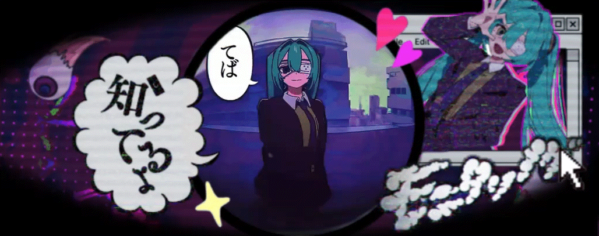

  <!-- Banner động -->
  

    

  <!-- Chữ chạy Typing SVG Pixel -->
  

    

  <!-- 2 GIF (gif1 và reze2) nằm 2 bên các nút liên hệ -->
  

    
    &nbsp;&nbsp;&nbsp;&nbsp;
    
    &nbsp;&nbsp;
    
    &nbsp;&nbsp;&nbsp;&nbsp;
    
  

---

### 
🛠️ Tech Stack

  <!-- Hàng 1: Ngôn ngữ & Framework chính -->
  
   
  <!-- Hàng 2: Message Queue, Database & Cloud -->
  

---

  <!-- GIF 3 ở dưới cùng trang -->
  

